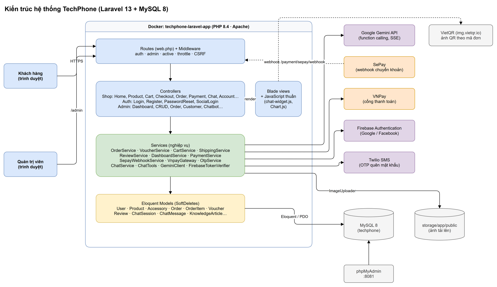
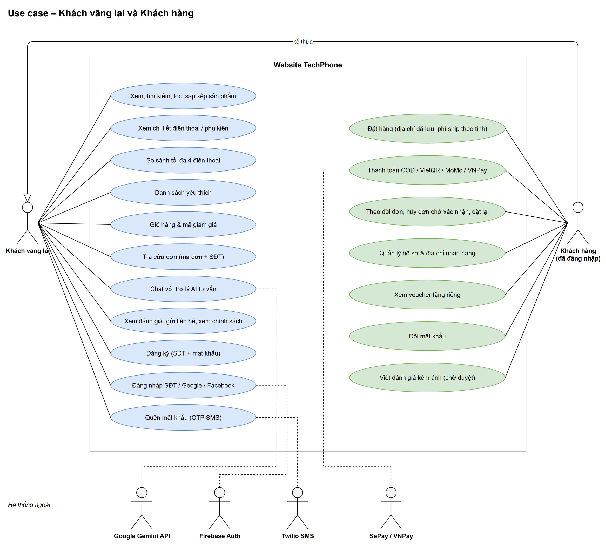
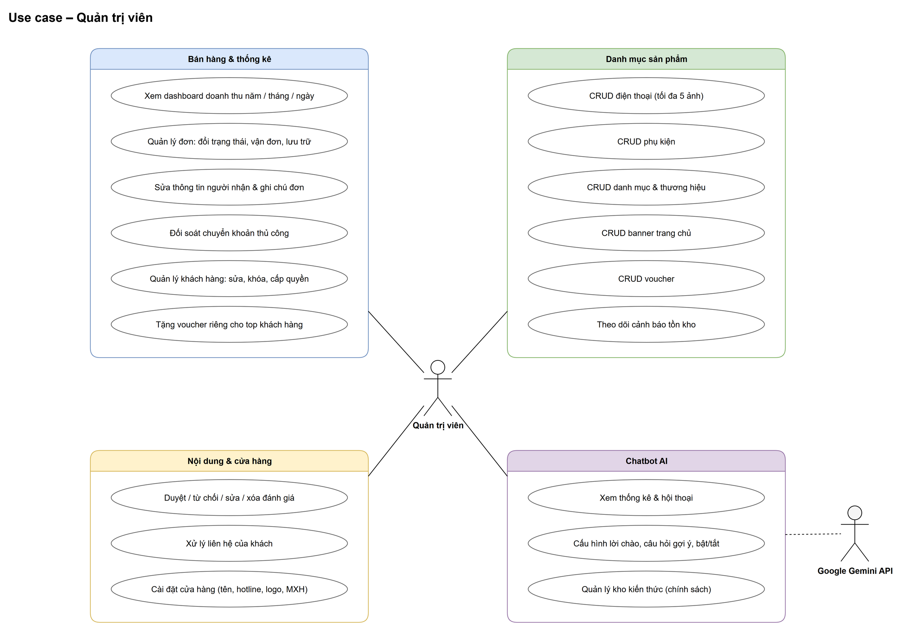
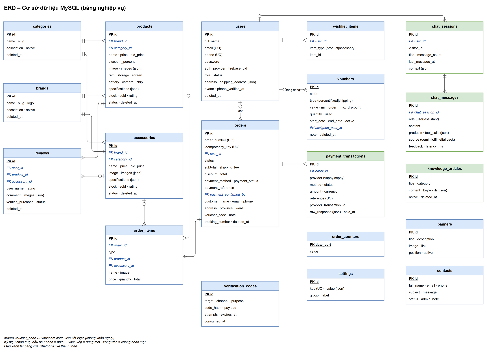
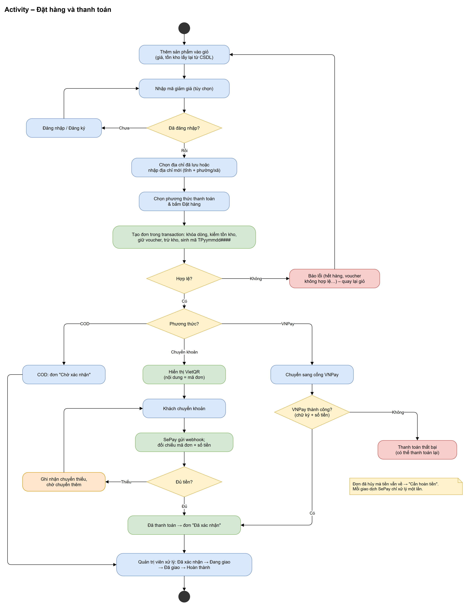
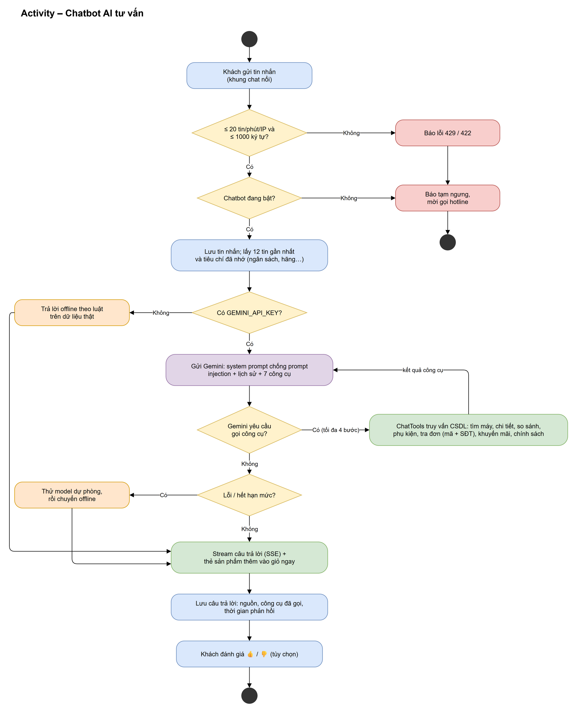
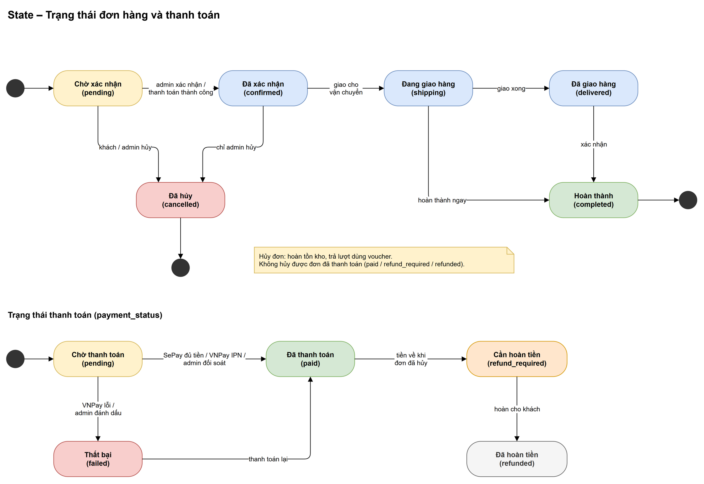
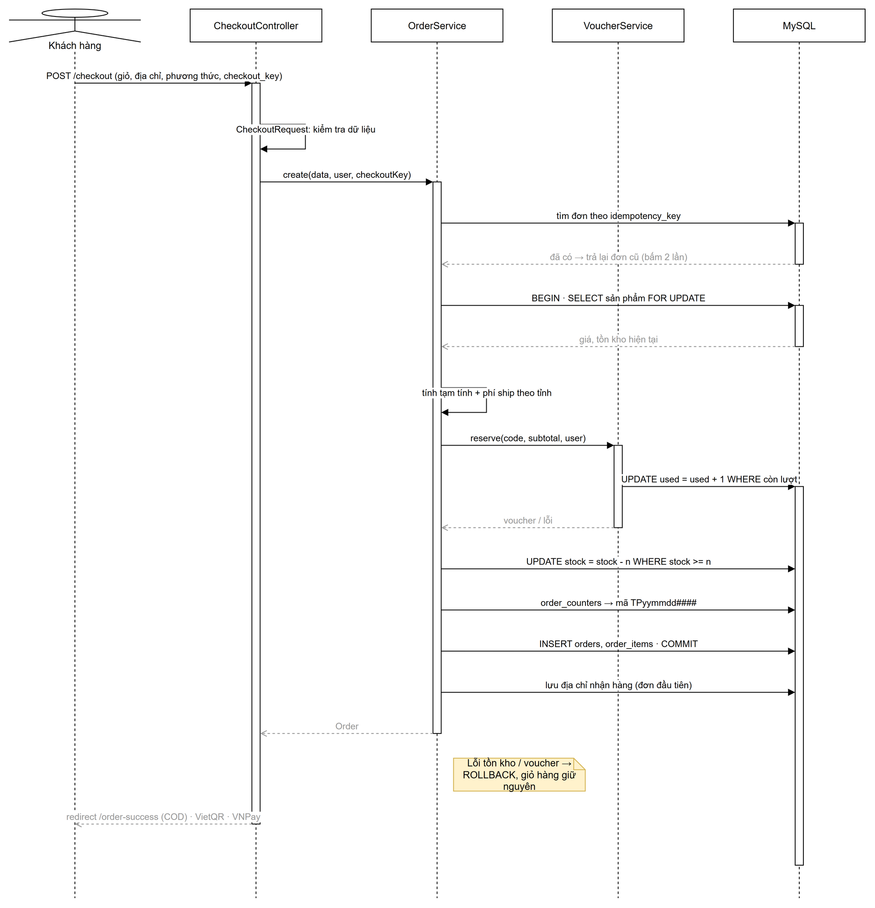
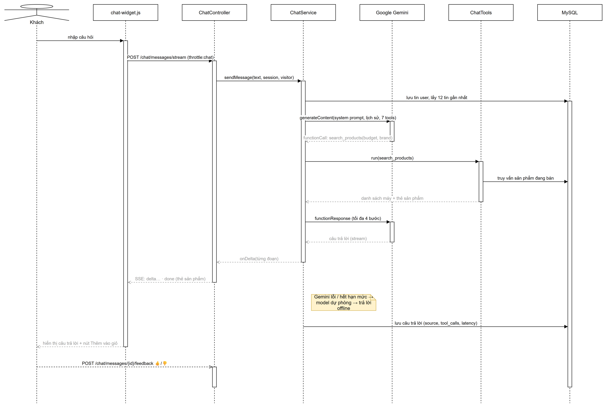
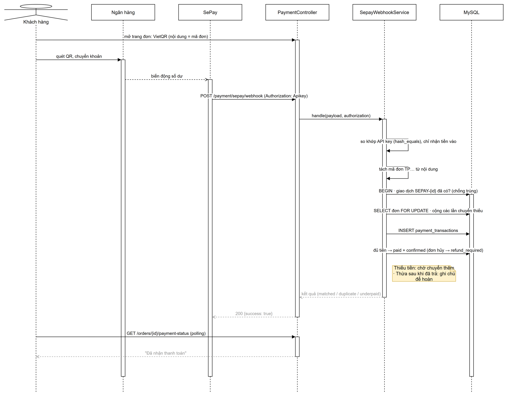

# Sơ đồ thiết kế – TechPhone (Laravel)

Mỗi sơ đồ có hai tệp:

- `*.drawio` – tệp gốc, mở bằng draw.io desktop hoặc <https://app.diagrams.net> để chỉnh sửa.
- `*.drawio.png` – ảnh 2x để chèn vào báo cáo. Ảnh có nhúng sẵn sơ đồ, kéo thả vào draw.io là sửa tiếp được.

Màu dùng chung: xanh dương = thành phần bán hàng, xanh lá = xử lý dữ liệu / thành công (và các bảng của Chatbot AI, thanh toán),
tím = dịch vụ AI / xác thực bên ngoài, cam = cổng thanh toán, đỏ = lỗi, vàng = điểm rẽ nhánh / ghi chú.

## Kiến trúc

| Sơ đồ | Nội dung |
|---|---|
| [kien-truc-he-thong](kien-truc-he-thong.drawio.png) | Trình duyệt → Routes/Middleware → Controllers → Services → Eloquent → MySQL; Gemini, SePay, VNPay, Firebase, Twilio, VietQR |



## Use case

| Sơ đồ | Nội dung |
|---|---|
| [usecase-khach-hang](usecase-khach-hang.drawio.png) | Khách vãng lai, khách hàng (kế thừa), hệ thống ngoài |
| [usecase-quan-tri](usecase-quan-tri.drawio.png) | Quản trị viên: bán hàng & thống kê, danh mục, nội dung, chatbot |




## Cơ sở dữ liệu

| Sơ đồ | Nội dung |
|---|---|
| [erd](erd.drawio.png) | 19 bảng nghiệp vụ MySQL (theo `database/migrations`) và khóa ngoại, ký hiệu chân quạ |



## Activity và State

| Sơ đồ | Nội dung |
|---|---|
| [activity-dat-hang-thanh-toan](activity-dat-hang-thanh-toan.drawio.png) | Giỏ hàng → đặt hàng trong transaction → COD / VietQR + SePay (chuyển thiếu) / VNPay → xử lý đơn |
| [activity-chatbot](activity-chatbot.drawio.png) | Giới hạn tần suất, bật/tắt, function calling với Gemini, dự phòng offline, stream SSE |
| [state-don-hang](state-don-hang.drawio.png) | Luồng trạng thái đơn hàng (`Order::TRANSITIONS`) và trạng thái thanh toán |





## Sequence

| Sơ đồ | Nội dung |
|---|---|
| [sequence-dat-hang](sequence-dat-hang.drawio.png) | `OrderService::create`: idempotency, khóa dòng, giữ voucher, trừ kho có điều kiện, mã đơn |
| [sequence-chatbot](sequence-chatbot.drawio.png) | `ChatService` gọi Gemini, Gemini yêu cầu công cụ, `ChatTools` truy vấn CSDL, stream về widget |
| [sequence-sepay](sequence-sepay.drawio.png) | Webhook SePay: xác thực API key, chống trùng, cộng chuyển thiếu, trang đơn tự cập nhật |





## Xuất lại ảnh

Sau khi sửa `.drawio`, xuất lại bằng draw.io desktop (File → Export as → PNG, bật "Include a copy of my diagram"), hoặc dòng lệnh:

```bash
draw.io -x -f png -e -s 2 -b 10 -o erd.drawio.png erd.drawio
```
